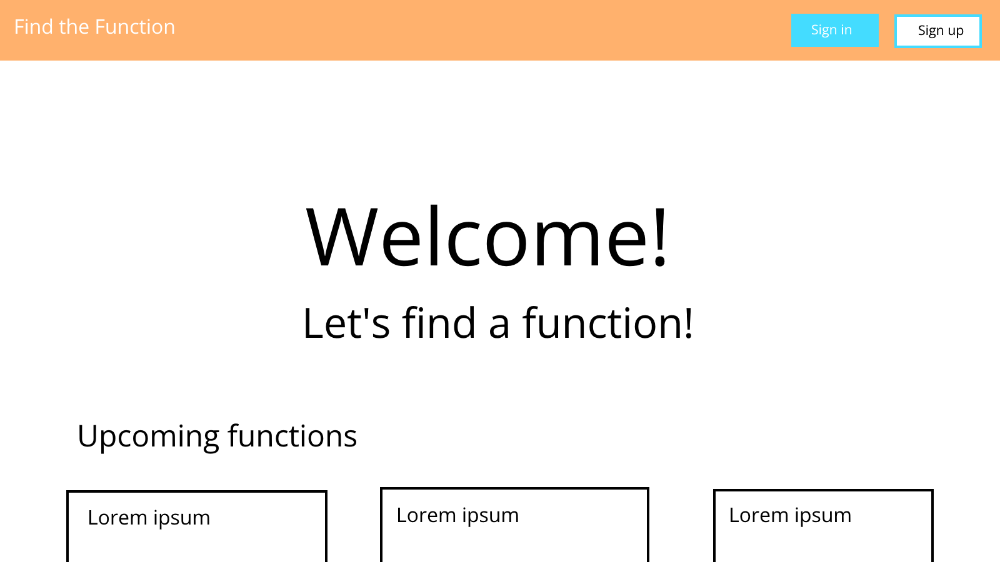
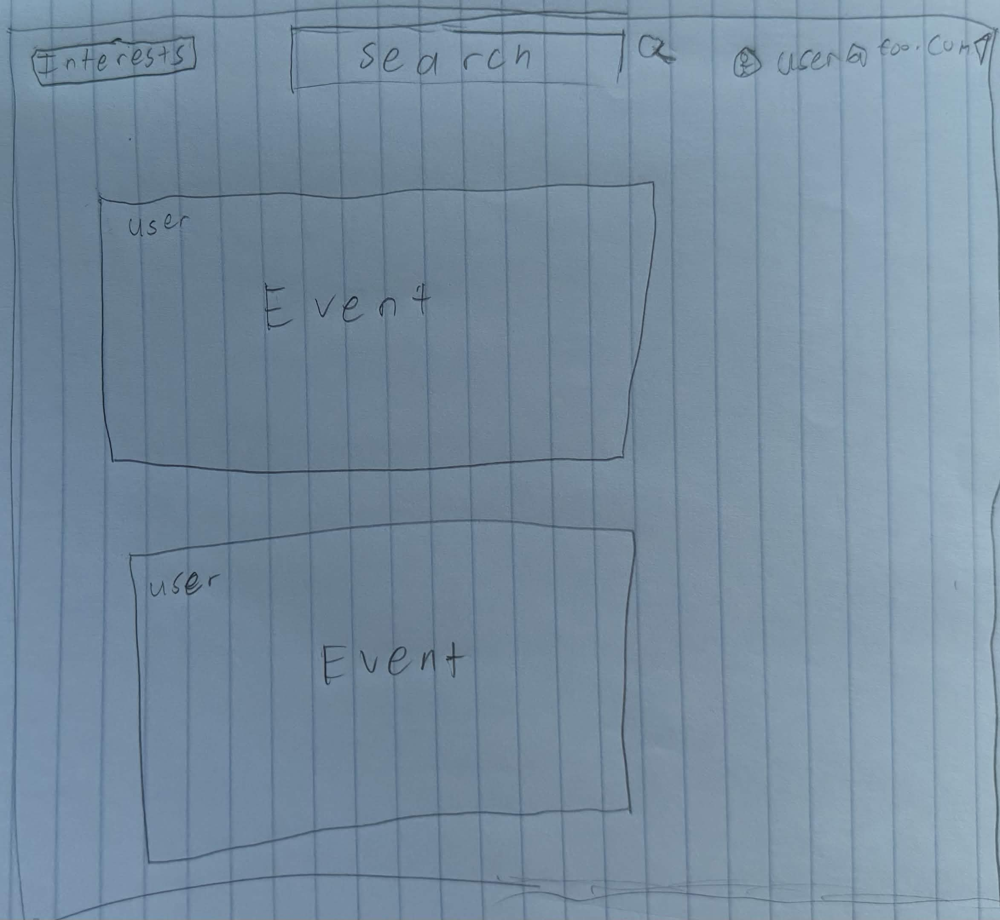
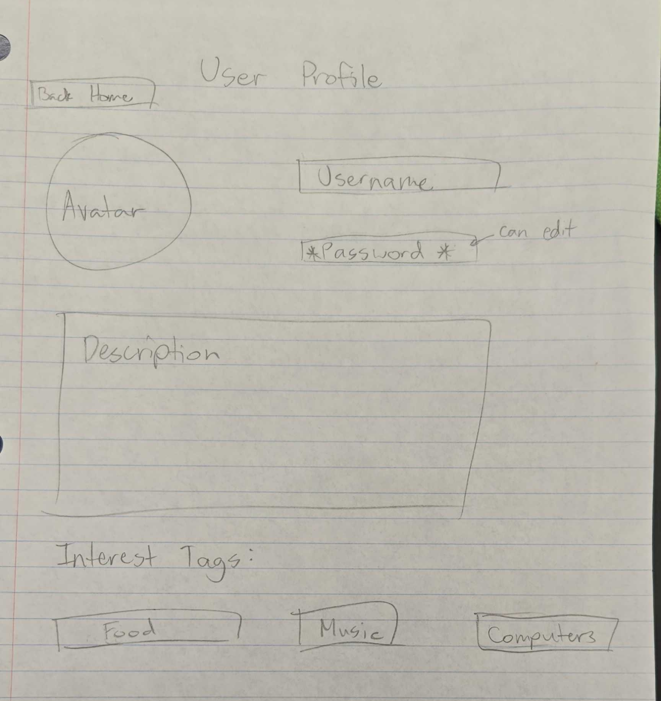
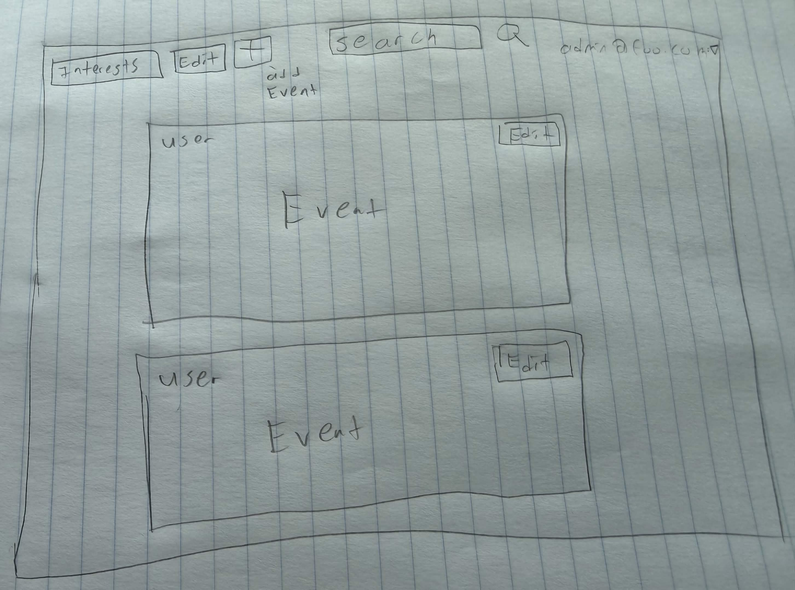

# Find the Function

## Table of Contents

* [Overview](#overview)
* [Page Mockups](#page-mockups)
* [Our Team](#our-team)

## Overview

### The Problem

Many UH students come from out of state. Once they arrive here, they don't have their own community or friends. It's difficult for them to experience the fun parts of campus life.

### The Solution

Find the Function provides an easy way for incoming and current students to discover a community that shares their interests.

## Page Mockups

### Landing Page

### User Homepage

### User Profile Page

### Admin home page

## Our Team

* **Jordan Wong** is a Computer Science major in his second year at UH Mānoa. He likes playing video games in his free time.
* **Jordan Shiroma** is a Computer Science major in his third year at UH Mānoa.
* **Stephanie Ching** is a Computer Science major in her third year at UH Mānoa. She likes reading and looks forward to gaining more experience in forming and running computer science projects.
* **Andrew Ishida** is a Computer Science major in their third year at UHM. They dedicate their free time to writing and playing games.

### Team Contract

https://docs.google.com/document/d/1ViUTyt8nWkhRRo5YUq3vbI1vyt_uwAQ-d9fYtBFMDrk/edit?usp=sharing
